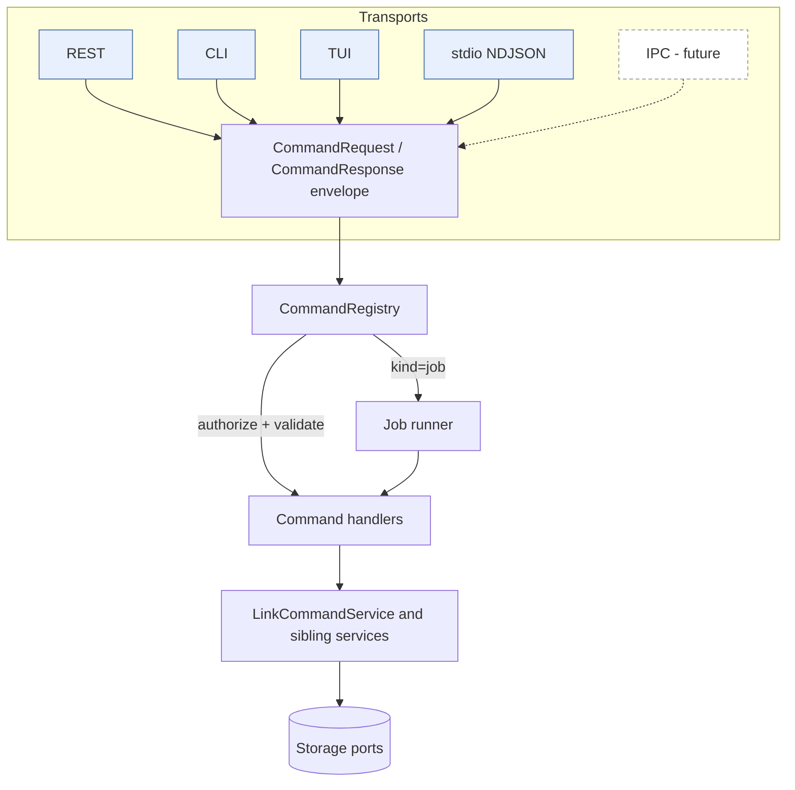

# 0002 - Unified Command Model (JSON commands and jobs, pluggable transports)

> **Status:** Proposed
>
> **Date:** 2026-10-19
>
> **Supersedes:** _(none)_ - **amends** [ADR 0001](/docs/adr/0001-cli-rest-shared-command-layer.md)
> (see "Relationship to ADR 0001")
>
> **Superseded by:** _(none)_
>
> **Roadmap:** [Milestone 0006](/docs/roadmap/0006-unified-command-model-and-tui/plan.md)
>
> **Companion:** [ADR 0003 - TUI](/docs/adr/0003-tui-framework-and-architecture.md);
> normative command catalog: [docs/commands/README.md](/docs/commands/README.md)

## Context

ADR 0001 gave REST and CLI one shared `LinkCommandService`, with one Config DTO
per command and two thin adapters. That removed duplicated *business logic*,
but the two adapters still each own a private, hand-written mapping:

- REST: HTTP request -> DTO (`link_handlers.cpp`), `Result<T>` -> status + JSON.
- CLI: `argv` -> DTO (`link_command_args.cpp`), `Result<T>` -> stdout + exit code.

Adding a third consumer (a TUI, then a web admin panel, a Tauri desktop shell,
an IPC client) with this shape means a third hand-written DTO mapping, a third
error mapping, and a third place where "what does `link.update` accept?" is
answered. The mappings are also the part that drifts: field names, defaults,
error codes and help text exist in three places.

New requirements (from the TUI request):

1. Every external command available over REST, CLI and TUI is the **same JSON
   command or job**, specified once in documentation and in code.
2. The command is **implemented in a single copy**; transports differ only in
   how they carry the JSON in and out.
3. Adding another transport (IPC, stdio sidecar, gRPC, ...) must be a small,
   local change.
4. The surface must be rich enough for a TUI that browses DB tables, inserts
   `full_URL -> short_URL` pairs and does "everything the CLI can".

## Decision

Introduce a **Command Model** one layer above `LinkCommandService`, built from
four pieces. Business logic stays where ADR 0001 put it; what is new is the
single, JSON-shaped contract in front of it.

### 1. Command envelope (the wire contract)

Every invocation, on every transport, is one JSON *request envelope* and
yields one JSON *response envelope*:

```json
// request
{ "v": 1, "id": "c-42", "command": "link.create",
  "args": { "target_url": "https://example.com/docs", "slug": "docs" },
  "options": { "dry_run": false, "async": false } }

// success
{ "v": 1, "id": "c-42", "ok": true,  "result": { "slug": "docs", "...": "..." } }

// failure
{ "v": 1, "id": "c-42", "ok": false,
  "error": { "code": "slug_conflict", "message": "slug already exists" } }

// accepted as a job (long-running commands, see below)
{ "v": 1, "id": "c-43", "ok": true, "job": { "id": "j-9", "state": "queued" } }
```

- `command` is a stable dotted name `<group>.<verb>`.
- `args` is a flat-or-nested JSON object defined by the command's
  **argument schema**; unknown keys are rejected (`invalid_field`).
- `result` for the nine existing link commands is **byte-identical** to the
  body the REST resource routes return today (same
  `serializeLinkViewJson`/`serializeLinkStatsJson`). This keeps contract C3 of
  Milestone 0003 (REST bodies unchanged) true by construction.
- `error.code` is the existing `AppErrorCode` vocabulary plus the new codes
  listed in the catalog (`not_authorized`, `unknown_command`,
  `invalid_envelope`, `unsupported`, `busy`, `job_cancelled`); an unknown job
  id is plain `not_found`. Codes that exist today keep their HTTP status and
  CLI exit code (`reserved_slug` stays 409); REST resource routes keep their
  legacy `error` strings (`invalid_request`, `repository`, `internal_error`)
  through legacy columns of the same single table.
- `id` is client-chosen and echoed; it never carries meaning for the server.

The envelope is versioned (`v`). Additive changes (new commands, new optional
args, new result fields) do not bump `v`.

### 2. Command descriptor and registry (the single copy)

```cpp
struct CommandDescriptor {
    std::string name;                 // "link.create"
    std::string summary;              // one line, used by --help, TUI, docs
    std::vector<ArgSpec> args;        // name, type, required, enum, doc, default
    Permission  permission;           // read | write | migrate | manage_users
    ExecutionKind kind;               // sync | job
    bool        mutating;             // drives TUI confirmation + audit
    bool        supports_dry_run;     // options.dry_run allowed
    bool        async_capable;        // sync command may run as a job (options.async)
    std::vector<std::string> maps_to; // doc only: REST route / CLI verb
    CommandHandler handler;           // (CommandContext&, ArgsView) -> CommandResult
};

class CommandRegistry {                // one instance per process
public:
    void add(CommandDescriptor);
    const CommandDescriptor* find(std::string_view name) const;
    std::vector<const CommandDescriptor*> list() const;
    CommandResponse execute(const CallerContext&, const CommandRequest&) const;
};
```

`CommandRegistry::execute` is the **only** entry point to business behavior
for any external transport. It performs, in order: envelope validation ->
command lookup -> permission check (`AccessGuard`) -> argument validation
against `ArgSpec` -> handler -> response envelope. A handler decodes the
validated args into the existing DTO (e.g. `app::UpdateLinkCommand`), calls the
`LinkCommandService` method, and encodes the `Result<T>` with the shared
serializer. Decode/encode live next to the handler, once.

`ArgSpec` is deliberately small (string, integer, boolean, enum, string-list,
string-map, object with declared string `fields`, timestamp; required/optional;
`nullable` for PATCH-style clears; default; doc). It is consumed by four things
generated from the one definition: argument validation, CLI `--help`, TUI form
generation, and the docs catalog (the block `3.7 Generated command reference`
of `docs/commands/README.md` is generated from the registry the same way
`docs/api/README.md` is generated from `RouteRegistry`; the prose sections are
hand-written and drift-tested).

No JSON library is added (CLAUDE.md constraint). **One sanctioned deviation
from the manual `core/utils.h` helpers:** a bounded, iterative,
dependency-free *top-level* scanner (`url_shortener::commands::scan_object` /
`scan_array`, Milestone 0006 Task 01.0 subtask 01). The `core/utils.h`
first-occurrence key search matches nested keys and string contents and cannot
enumerate keys, so it cannot implement "unknown keys are rejected" or a safe
envelope parse. The scanner is the only JSON tokenizer in product code: the
envelope parser, `ArgsView`, the REST/CLI args builder and the TUI all use it;
it builds no DOM. Results are still serialized by the existing manual
serializers. This deviation is an open decision for human review (decision log,
"Open decisions needing human review"). If the argument surface outgrows the
scanner, a JSON dependency becomes a *separate* ADR, not a side effect of this one.

### 3. Jobs

A command whose descriptor has `kind = job` (e.g. `link.import`,
`link.export`; a future `migrate`-permission command would be one too, none is
defined in this milestone) never blocks the caller. `execute` returns the
`job` envelope immediately; progress and outcome are read with the ordinary
commands `job.get`, `job.list`, `job.cancel`. A sync-kind command may also be
run as a job with `options.async = true` if its descriptor marks it
`async_capable`; otherwise `unsupported`.

Job lifecycle: `queued -> running -> succeeded | failed | cancelled`. A job
record holds `{id, command, args_digest, state, progress{done,total},
result|error, created_at, finished_at}`. Jobs run on one process-wide, small
bounded worker pool inside the process that owns the registry (one per process,
even when REST builds a registry per request) (same bounded-queue,
drop-nothing-silently discipline as the analytics worker, but a full queue
returns `error.code = "busy"`, it never drops). Job state is in-memory in V1
and lost on restart; durable jobs are an explicit non-goal.

### 4. Transport adapters (the only thing that differs)

An adapter owns exactly three responsibilities: *frame in* (turn the
transport's native input into a `CommandRequest`), *call*
`CommandRegistry::execute`, *frame out* (turn the `CommandResponse` into the
transport's native output). Adapters contain no business rules and no
per-command code.

```cpp
struct ITransportAdapter {
    virtual ~ITransportAdapter() = default;
    virtual std::string_view name() const = 0;   // "rest", "cli", "tui", "stdio", ...
    virtual int run(CommandRegistry&) = 0;       // owns its own loop / one-shot
};
```

| Adapter | Frame in | Frame out | Caller identity |
|---|---|---|---|
| REST generic | `POST /api/v1/commands` body = request envelope | HTTP 200/4xx/5xx + response envelope | until Milestone 0002: off by default (`--command-api-enabled`), fixed role from `--command-api-role` (default `user`); later the session (0002 C2) |
| REST resource routes (existing) | method + path + body mapped by a static route->command table | unchanged bodies/status codes | same |
| CLI one-shot | `url_shortener cmd <name> [--json '{...}' \| --arg k=v ...]`, plus the existing `link <verb>` sugar compiled to the same request | envelope (or `result` only with `--raw`) on stdout, exit code from `error.code` | local operator |
| TUI | form fields / table actions | rendered widgets | local operator |
| stdio NDJSON (`url_shortener serve-stdio`) | one request envelope per stdin line | one response envelope per stdout line | local operator (parent process) |
| IPC (future) | Unix domain socket / named pipe, same NDJSON framing | same | peer credentials |

Adding IPC (or gRPC, or a Tauri sidecar channel) means writing one class that
implements `ITransportAdapter` and registering it in `src/composition/`. No
command, descriptor, DTO or serializer changes. The stdio adapter ships in
this milestone precisely as the proof of that claim and as the intended
attachment point for a Tauri sidecar.

### Dependency direction

```text
  REST handlers   CLI parser   TUI screens   stdio loop   [future IPC]
        \              |            |             |            /
         +-------------+-----+------+-------------+-----------+
                             v        (all speak CommandRequest/CommandResponse)
                    +---------------------+
                    |   CommandRegistry   |  validate, authorize, dispatch, jobs
                    +----------+----------+
                               v
                    +---------------------+
                    |  command handlers   |  JSON args <-> DTO, Result<T> <-> JSON
                    +----------+----------+
                               v
              LinkCommandService / BrowseService / ImportExportService
                               v
        IMetadataRepository  ICacheStore  IClickEventRepository  (ports)
```



### Authorization

Each descriptor names the `Permission` it needs (`read`, `write`, `migrate`,
`manage_users`), enforced by `AccessGuard` inside `execute`, never in an
adapter. The adapter supplies a `CallerContext {principal, ControlSet,
transport}`. Remote transports (REST, future IPC with remote peers) derive it
from the authenticated session. Until Milestone 0002 provides sessions, the
REST server has no authentication, so the *new* HTTP surface
(`/api/v1/commands`, `GET /api/v1/links`, `/api/v1/jobs*`) is disabled by
default and, when enabled, runs with one configured role (`user` by default;
`admin` honored only for loopback peers), and `manage_users` commands are
always refused over REST. The pre-existing resource routes keep today's open
behavior (they run as `Admin`, Milestone 0003 C3). Local one-shot/interactive transports (CLI,
TUI, stdio) run as the local operator: the person who can start the process
already controls the data directory and credentials, which is the same trust
boundary the existing CLI has. A `--read-only` switch downgrades a local
session to `ControlSet::User`. The auth broker rule from `CLAUDE.md` (local
only, never `0.0.0.0`) is unchanged.

Every mutating command emits one audit line (principal, transport, command,
slug/id, outcome - never args values that may hold secrets) through an
`IAuditSink` that the composition root (`composition::build_command_runtime`)
always installs.

## Alternatives Considered

| Alternative | Pros | Cons | Reason rejected |
|---|---|---|---|
| Keep ADR 0001 as is; add a TUI adapter with its own DTO mapping | No new layer | Third copy of arg/error mapping; TUI forms hand-maintained; docs triple-maintained | The drift this ADR exists to remove |
| TUI/CLI call the local REST server over HTTP | Zero new code path | Needs a running server and credentials; breaks "CLI never starts a listener"; no offline TUI | Same reasons ADR 0001 rejected it |
| JSON-RPC 2.0 as the envelope | Existing standard, tooling | Positional/batch/notification features unused; no job concept; error-code model differs from `AppErrorCode` | Envelope is intentionally JSON-RPC-shaped (`id`, `result`/`error`); adopting the spec adds nothing here. Revisit if an IPC peer requires it |
| gRPC/protobuf contract | Strong typing, codegen | New heavy dependency, Windows/vcpkg cost, not human-writable on CLI | Over-weight for a single-binary tool; can be a future adapter |
| One DTO type per command exposed to adapters (status quo) | Compile-time safety in adapters | Adapters must know every DTO | Replaced by schema-driven args; DTOs stay internal to handlers |
| **Descriptor registry + JSON envelope + pluggable adapters (chosen)** | One definition drives validation, help, forms, docs, REST/CLI/TUI/IPC | New layer; runtime (not compile-time) arg checking | Accepted; handler tests + catalog-conformance tests recover the safety |

## Consequences

### Positive

- One definition of each command; help text, TUI forms and the docs catalog are
  generated from it and cannot drift from behavior.
- New transport = one `ITransportAdapter`; new command = one descriptor +
  handler, instantly present in REST, CLI, TUI and stdio.
- A conformance test suite can replay one corpus of request envelopes through
  every adapter and assert identical response envelopes - the executable form
  of "identical commands".
- Jobs give import/export/migrate a uniform progress and cancel story for all UIs.

### Negative

- Argument validation moves from compile time (typed DTOs in adapters) to run
  time (`ArgSpec`). Mitigated by the conformance corpus and per-handler tests.
- Existing REST resource handlers and `link <verb>` parsers must be re-pointed
  at the registry. REST bodies/status codes must stay unchanged (characterization
  tests from Milestone 0003 are the guard).
- The storage-path gap becomes much more visible once a long-lived TUI
  browses "the database". ADR 0001 described it as a duality (redirects on the
  pluggable repository, commands on the in-memory singleton); reading the code
  (Milestone 0006 Task 02.0) showed that the pluggable backend is not wired into
  the live path at all: `BuildStorageAdapters` and `core::LinkService` are used
  only by tests, `main` never reads a `StorageConfig`, and redirects, REST and
  CLI all use the legacy in-memory singletons. The fix is therefore to *wire*
  the configured backend into the live path for the first time (and teach it
  to carry a full `Link`), not to "reconnect" the redirect path. It must be done
  in this milestone (Task 02.0) rather than carried forward again.

### Non-goals

- Replacing the redirect fast path, observability endpoints, compatibility
  aliases or the generic URI-store fallback with commands (same exclusions as
  ADR 0001; `GET /{slug}` stays outside the registry).
- Durable/distributed job queues; multi-user collaborative TUI sessions.
- A JSON library, protobuf, or a network-exposed IPC listener.
- Implementing the web admin console (Milestone 0002), public web UI
  (Milestone 0004) or a Tauri shell - they *consume* this model later.

## Relationship to ADR 0001

ADR 0001's decision stands for everything below the registry: Config DTO per
command, one `LinkCommandService` method per command, shared serializers.
This ADR **amends only the adapter layer**: instead of each transport owning a
DTO mapping, transports own an envelope mapping and the registry owns the
(single) DTO mapping. ADR 0001's status becomes `Accepted (amended by 0002)`
when this ADR is accepted.

## Validation / Rollout

Staged by tasks in Milestone 0006: spec and catalog first (docs-only, reviewable),
then registry with the nine link commands behind a conformance corpus, then
REST/CLI re-pointed with characterization tests green, then browse/import
commands, then stdio adapter, then TUI.

## Links

- [Command catalog](/docs/commands/README.md)
- [ADR 0003 - TUI](/docs/adr/0003-tui-framework-and-architecture.md)
- [Milestone 0006 plan](/docs/roadmap/0006-unified-command-model-and-tui/plan.md)
- [Decision log (questions deferred to the user)](/docs/roadmap/0006-unified-command-model-and-tui/decision-log.md)
