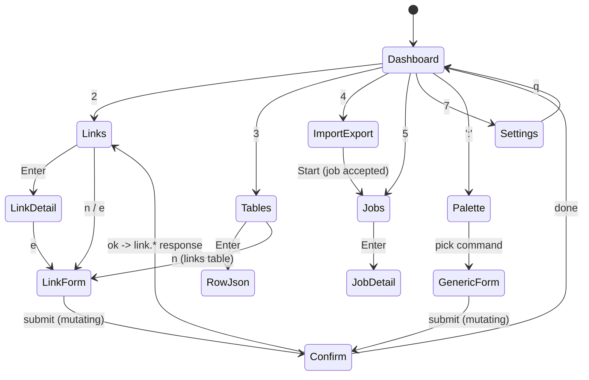
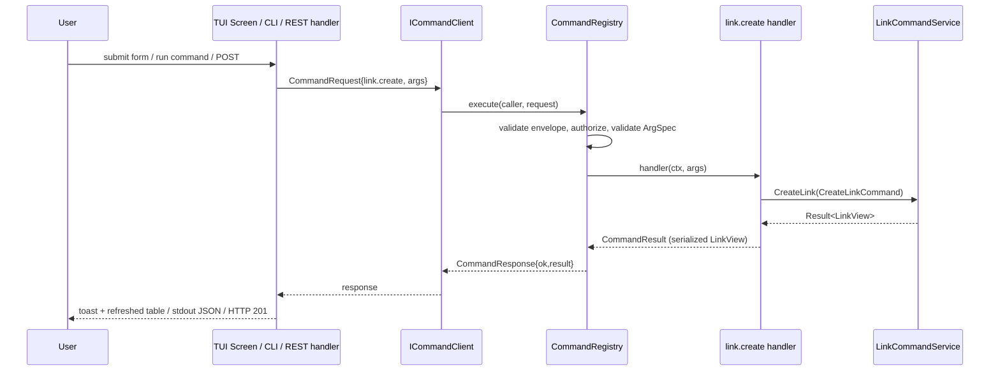

# 0003 - TUI Framework and Architecture

> **Status:** Proposed
>
> **Date:** 2026-10-19
>
> **Supersedes:** _(none)_
>
> **Superseded by:** _(none)_
>
> **Depends on:** [ADR 0002 - Unified Command Model](/docs/adr/0002-unified-command-model.md)
>
> **Roadmap:** [Milestone 0006](/docs/roadmap/0006-unified-command-model-and-tui/plan.md), Task 06.0

## Context

An interactive terminal UI is required alongside the CLI, exposing **every**
command the CLI (and REST) can run, plus: viewing database tables, inserting
`full_URL -> short_URL` pairs, and general link management. It must be written
in C++17 (project rule), live in the same binary, work on Windows (primary
dev platform), Linux and macOS, and must not contain business logic - it is a
transport adapter over the command model of ADR 0002.

## Decision 1 - Library: FTXUI

Use **FTXUI** (`ArthurSonzogni/FTXUI`, MIT).

| Candidate | C++17 | Windows | Deps | Model | Verdict |
|---|---|---|---|---|---|
| **FTXUI** | yes (library itself is C++17) | native (Win32 console + VT) | none | declarative, functional components; built-in `Menu`, `Input`, `Dropdown`, `Checkbox`, `Table`, `Container`, `Renderer`, `ScreenInteractive` | **chosen** |
| notcurses | C core, C++ bindings need newer standards in practice | weak/experimental | many | very capable (graphics, multimedia) | overkill; poor Windows story |
| ncurses / PDCurses (+ CDK/NCursesW wrappers) | C API | PDCurses fork needed | system lib | imperative, manual layout | most portable on Unix, but hand-rolled widgets and two curses flavours |
| cpp-terminal | yes | yes | none | thin terminal I/O; no widget set | too low-level; we would write the widgets |
| ImTui | yes | partial | Dear ImGui | immediate-mode | little maintained; drags ImGui in |
| Terminal.Gui, Textual, Ratatui, Bubble Tea | n/a | - | - | - | not C++ |

Why FTXUI: the most widely adopted modern C++ TUI library (largest C++ TUI
community, active releases, used in many open-source tools), zero external
dependencies, first-class Windows support, an element/component split that
maps cleanly to our "forms generated from descriptors" design, and it is
packaged in vcpkg (`ftxui`) and trivially fetched with CMake `FetchContent`,
matching how `yaml-cpp`/`hiredis`/`SOCI` are already handled. The exact
version is pinned at implementation time (Task 06.0 subtask 01); the chosen
release must compile as C++17.

The TUI is built behind CMake option `URLSHORTENER_ENABLE_TUI` (default `ON`).
Everything outside `src/tui/` compiles and runs without FTXUI.

## Decision 2 - Architecture: TUI is a transport adapter plus a client seam

```text
+--------------------------------------------------------------------+
| src/tui/                                                           |
|  App (ScreenInteractive loop)                                      |
|   +-- Router: Screen stack, hotkeys, focus                         |
|   +-- Screens: Dashboard | Links | Tables | Import | Jobs | Palette|
|   +-- FormBuilder: ArgSpec[] -> FTXUI form components (generic)    |
|   +-- TableView:  paged rows -> FTXUI table, sort/filter/search    |
|   +-- Theme, Help overlay, Toast/Confirm dialogs                   |
|                |                                                   |
|                v  ICommandClient::call(CommandRequest)             |
|   +-----------------------------------------------------------+    |
|   | InProcessClient (default) -> CommandRegistry::execute     |    |
|   | [future] RemoteClient    -> REST / IPC / stdio transport  |    |
|   +-----------------------------------------------------------+    |
+--------------------------------------------------------------------+
```

Rules:

1. **Only `ICommandClient` crosses out of the TUI.** No screen includes
   `LinkCommandService`, a repository, or a DTO. Screens build
   `CommandRequest`s and render `CommandResponse`s. This is what keeps "the
   command is implemented once".
2. **Generic first, bespoke second.** `FormBuilder` renders *any* command
   from its `ArgSpec` list, so every registry command is reachable the moment
   it is registered (via the Command Palette). Bespoke screens (Links table,
   Tables browser, Import) are conveniences layered on the same calls.
3. **Never block the UI thread.** Sync commands run on a worker and post the
   response back via FTXUI's `ScreenInteractive::PostEvent`; jobs are polled
   with `job.get` on a timer and shown in the Jobs screen.
4. **Mutations confirm.** Descriptors with `mutating = true` show a confirm
   dialog (skippable with `--yes` for scripted/test runs); `link.delete`
   requires typing the slug. (A future `migrate`-permission command would
   require typing `MIGRATE`; none exists in Milestone 0006, the confirm policy
   keeps the rule reserved.)
5. **Read-only mode:** `url_shortener tui --read-only` runs the session as
   `ControlSet::User`; write screens render disabled with the registry's
   `not_authorized` reason, not hidden.
6. **Headless testability:** `ICommandClient` is mockable; screens render to
   FTXUI `Screen` buffers, so layout is snapshot-tested without a terminal.
7. **No secrets on screen.** The Tables browser can only show ports-backed
   logical tables (`links`, `click_events`, `jobs`); auth/session tables and
   any column holding a hash, token or salt are not browsable (enforced in
   the `db.*` handlers, not in the TUI).

## Launching

```text
url_shortener tui [--storage-config <file>] [--read-only] [--yes] [--theme dark|light|mono]
```

Like CLI one-shot mode, TUI mode never starts `HttpServer` or binds a socket.
Console logging would corrupt the screen and the logger is enabled with a
`stderr` sink even when `LoggerFactory::Initialize` is never called, so TUI
mode initializes logging explicitly as disabled, or with a `File` sink when a
log file is configured (Task 06.0 subtask 19).
It requires a persistent backend to be useful beyond one session (see Task
02.0, storage-path unification); with the in-memory backend the TUI works
within the session and shows a persistent "memory store - data is lost on
exit" banner.

## Design diagrams

Terminals are 80x24 minimum; layouts below are 80 columns. `[F1]` etc. are
default hotkeys; every action is also reachable from the Command Palette.

### D1. Frame and navigation

```text
+- url_shortener -- backend: sqlite (links.db) -- user: local/Admin ---------[F1 Help]-+
| [1]Dashboard [2]Links [3]Tables [4]Import/Export [5]Jobs [6]Analytics [7]Settings [:]Palette |
+--------------------------------------------------------------------------------------+
|                                                                                      |
|                          << active screen body >>                                    |
|                                                                                      |
+--------------------------------------------------------------------------------------+
| j/k move  Enter open  n new  e edit  d delete  / filter  r refresh  q back  Ctrl-C quit|
+--------------------------------------------------------------------------------------+
```

`[6]Analytics` is a placeholder tab in Milestone 0006 ("provided by Milestone
0002"); it has no command, no node in D11 and no screen beyond the placeholder.

### D2. Dashboard

```text
+- Dashboard ---------------------------------------------------------------------+
| Links total: 1,204   active: 1,180   disabled: 9   deleted: 15                  |
| Redirects (24h): 48,311   success: 99.2%   p50 redirect: 0.4 ms                 |
|                                                                                  |
| Top slugs (24h)                         Recent changes                           |
|  docs        12,044 ######## ...         10:42 link.create   docs2   ok          |
|  launch       8,730 ######               10:40 link.disable  promo   ok          |
|  promo        4,112 ###                  10:31 link.update   docs    ok          |
|                                                                                  |
| Jobs: 1 running (link.import 62%)        Backend: sqlite  Cache: redis (ok)      |
+----------------------------------------------------------------------------------+
```

Data sources (D2 is aspirational in part): link counts come from `link.list`
`total` per `status`, the jobs line from `job.list`, the backend line from
`system.info`, "Recent changes" from `link.list` sorted by `updated_at` (slug
and status, not the command name).
Redirects (24h), success %, p50 latency and "Top slugs" have **no source
command** in Milestone 0006; Task 06.0 subtask 17 renders them as "n/a" until a
future `stats.summary` command exists (recorded, not designed here).

### D3. Links table (`link.list`)

```text
+- Links ---- filter: [camp:spring        ]  status: (all) active disabled deleted -+
| SLUG       TARGET URL                                  STATUS    CLICKS EXPIRES  |
|>docs       https://example.com/docs/getting-started    active     12044  -        |
| launch     https://example.com/launch?utm_source=tw... active      8730  2026-12  |
| promo      https://shop.example.com/promo              disabled    4112  -        |
| old-blog   https://example.com/blog/2019/hello         deleted        7  -        |
|                                                                                   |
|                                                          page 1/61  (20 per page) |
+-----------------------------------------------------------------------------------+
| Enter detail  n new  e edit  t toggle  d delete  u restore  p preview  s stats   |
+-----------------------------------------------------------------------------------+
```

### D4. Link detail / stats / preview (`link.get`, `link.stats`, `link.preview`)

```text
+- Link: docs ----------------------------------------------------[e]dit [s]tats -+
| id          01HZX...K3                  short URL   https://sho.rt/docs          |
| target      https://example.com/docs/getting-started                             |
| status      active (enabled)            redirect    temporary                |
| created     2026-09-02T10:14:00Z        expires     -                            |
| tags        docs, public                campaign    spring / email / launch      |
| metadata    owner=web-team                                                       |
|                                                                                  |
| Stats (7d)  attempts 84,210  success 83,720  [bucket: day]                       |
|  Mon ####### Tue ######## Wed ########## Thu ######## Fri ##### Sat ## Sun ###   |
+----------------------------------------------------------------------------------+
```

### D5. New / edit link form (generated from `link.create` / `link.update` ArgSpec)

```text
+- New link  (command: link.create) -------------------------------------------+
| target_url*  [https://example.com/very/long/path                           ] |
| slug         [docs                    ]   (blank = generated)                |
| redirect     ( ) permanent  (*) temporary                                    |
| expires_at   [                        ]   ISO-8601, blank = never            |
| enabled      [x]                                                              |
| tags         [docs, public            ]   comma separated                    |
| metadata     [owner=web-team          ]   key=value, comma separated         |
| campaign     [name] [source] [medium]                                         |
|                                                                               |
|  [ Create ]  [ Cancel ]      validation: target_url ok - slug ok              |
+-------------------------------------------------------------------------------+
|  Equivalent: url_shortener cmd link.create --json '{"target_url":"..."}'     |
+-------------------------------------------------------------------------------+
```

The "Equivalent" footer shows the exact envelope/CLI form of whatever the
form would send - a teaching aid and the visible proof that all UIs are the
same command.

### D6. Database tables browser (`db.tables`, `db.rows`)

```text
+- Tables -------------------+- links  (1,204 rows)  sort: created_at v -----------+
| > links           1,204    | ID        SLUG     TARGET                CREATED   |
|   click_events  912,550    | 01HZX..K3 docs     https://example.com.. 09-02      |
|   jobs               3     | 01HZX..M8 launch   https://example.com.. 09-05      |
|                            | 01HZX..P1 promo    https://shop.example. 09-11      |
|  (read-only logical views  |                                                     |
|   over storage ports;      | / search  s sort  c columns  Enter row JSON         |
|   no auth/secret tables)   | n insert row -> New link form      page 1/61        |
+----------------------------+-----------------------------------------------------+
```

"Insert" on the `links` table opens D5; on other tables it is absent
(`click_events` and `jobs` are read-only). Row JSON view shows the exact
`result` item the command returned.

### D7. Import / export pairs (`link.import`, `link.export`) - job-backed

```text
+- Import pairs  (command: link.import, runs as a job) -----------------------+
| Source:  (*) paste   ( ) file path [                         ]               |
| Format:  (*) CSV  full_url,slug           ( ) NDJSON                          |
| On conflict: (*) skip   ( ) fail   ( ) overwrite                              |
|  +-----------------------------------------------------------------------+   |
|  | https://example.com/a,a                                               |   |
|  | https://example.com/b,b                                               |   |
|  | https://example.com/c,                 <- blank slug = generated      |   |
|  +-----------------------------------------------------------------------+   |
|  [x] dry run (validate only)           [ Start import ]  [ Cancel ]           |
+-------------------------------------------------------------------------------+
   after Start ->  Jobs screen:  j-9 link.import  running  ####----  62%  [c]ancel
```

### D8. Jobs (`job.list`, `job.get`, `job.cancel`)

```text
+- Jobs ------------------------------------------------------------------------+
| ID   COMMAND       STATE      PROGRESS        STARTED   FINISHED   OUTCOME     |
|>j-9  link.import   running    ######----  62%  10:44:02  -          -           |
| j-8  link.export   succeeded  ##########100%   10:31:10  10:31:12   312 rows   |
| j-7  link.import   failed     ####------  38%  10:20:40  10:20:41   invalid_url|
+-------------------------------------------------------------------------------+
| Enter detail (full error envelope)  c cancel  r refresh (auto 1s)               |
+-------------------------------------------------------------------------------+
```

### D9. Command Palette - every command, always reachable

```text
+- Command palette ---------------------------------------------------------------+
| : link.[                                                                       ] |
|   link.create     Create a short link                          write            |
|   link.get        Fetch a link by slug or id                   read             |
|   link.list       List links (filter, page)                    read             |
|   link.update     Partially update a link                      write            |
|   link.delete     Soft-delete a link                           write  (confirm) |
|   link.enable / link.disable / link.restore / link.preview / link.stats         |
|   link.import / link.export        (jobs)                                       |
|   db.tables / db.rows              job.get / job.list / job.cancel              |
|   system.info / command.list                                                    |
+--------------------------------------------------------------------------------+
```

Selecting a command opens the `FormBuilder` form for its `ArgSpec`s (D5
pattern), so a command added to the registry appears here, with a working
form, with zero TUI code.

### D10. Confirm and error toast

```text
+- Delete link ------------------------+     +- ! slug_conflict ---------------------+
| Soft-delete "promo"?                 |     | slug "docs" already exists.           |
| Type the slug to confirm: [promo   ] |     | (link.create, id c-42)   [d]etails    |
|     [ Delete ]   [ Cancel ]          |     +---------------------------------------+
+--------------------------------------+
```

Errors are always the response envelope's `error.code` + `message`; the
`[d]etails` key shows the raw envelope.

### D11. Screen state machine



### D12. Sequence - one create, same on every transport



### D13. Shortener settings (`system.info`)

```text
+- Settings -----------------------------------------------------------------------+
| Version        1.0.0                     Read-only session   no                  |
|                                                                                   |
| Backend                                   Shortener                              |
|  metadata     sqlite  (persistent)         base domain      http://sho.rt         |
|  cache        redis                        generated slug length   7             |
|  analytics    sqlite                       default redirect type   temporary     |
|  rate limit   redis                         default expiry          never         |
|                                             allow private targets   false         |
|                                             analytics enabled       true          |
|                                                                                   |
| Request hardening                                                                |
|  max request body        65536 bytes      max request target    2048 chars       |
|  max request id length   64 chars                                                |
|                                                                                   |
| Read-only view - change these with CLI flags / env vars and restart; no command   |
| mutates them yet (ADR 0002 "no `settings.set`" - see Consequences / Non-goals).   |
+-----------------------------------------------------------------------------------+
|  r refresh  q back                                                                |
+-----------------------------------------------------------------------------------+
```

Backed entirely by `system.info` (ADR 0002, Task 03.0 subtask 17): the `backend`/`persistent`/`read_only`
fields already existed for the status bar and Dashboard; this screen adds the `shortener` block (the
non-secret `ServerConfig` fields: base domain, generated slug length, default redirect type, default expiry,
`allow_private_targets`, `analytics_enabled`, and the three request-hardening limits) as a dedicated,
full-screen view rather than a one-line status summary. There is no `settings.set` command and none is
planned for this milestone - `ServerConfig` is parsed once from CLI flags/env at startup and has no
runtime-mutation path today (Milestone 0003's own finding, ADR 0001), so a write form here would be a second,
inconsistent way to configure the server. The screen is therefore always read-only, even for `ControlSet::Admin`
- it is a rendering concern, not a case of the Read-only-mode rule (rule 5) disabling a write control. TLS
settings, listener ports and `analytics_client_hash_salt` are deliberately never shown (never read by
`system.info` at all, not merely hidden): see 03.0/17's Dependencies section for the exact, named exclusion
list.

## Alternatives Considered

(Library alternatives in Decision 1.) For architecture: **bespoke screens
calling services directly** was rejected because it recreates the third copy
of command mapping ADR 0002 removes; **TUI over local HTTP** was rejected for
the same offline/listener reasons as in ADR 0001.

## Consequences

### Positive

- Every registry command is usable in the TUI automatically; CLI parity is
  structural rather than a checklist.
- TUI can later target a remote server by swapping `InProcessClient` for a
  `RemoteClient` (REST or IPC) - the screens do not change.
- Layouts are snapshot-testable with no terminal.

### Negative

- New third-party dependency (FTXUI) and a new directory of UI code to maintain.
- FTXUI is not a full-featured grid control: very wide tables need horizontal
  scrolling and column hiding that we implement in `TableView`.
- Terminal rendering differences (legacy Windows consoles, tmux) need a
  `--theme mono`/ASCII-borders fallback and manual smoke checks.

### Non-goals

- Mouse-first UX, theming engine, plugin screens, charts beyond bar sparklines.
- Analytics deep-dives (fingerprints, suspicion scores) - Milestone 0002 owns those.
- **Editable settings.** The Settings screen (D13) is read-only in this milestone; there is no
  `settings.set` command. `ServerConfig` has no runtime-mutation path to call even if the TUI wanted one
  (confirmed against the current startup flow); adding one is a separate, future decision, not an oversight.

## Links

- [ADR 0002](/docs/adr/0002-unified-command-model.md)
- [Command catalog](/docs/commands/README.md)
- [Milestone 0006 Task 06.0](/docs/roadmap/0006-unified-command-model-and-tui/06.0-tui/README.md)
- FTXUI: https://github.com/ArthurSonzogni/FTXUI
